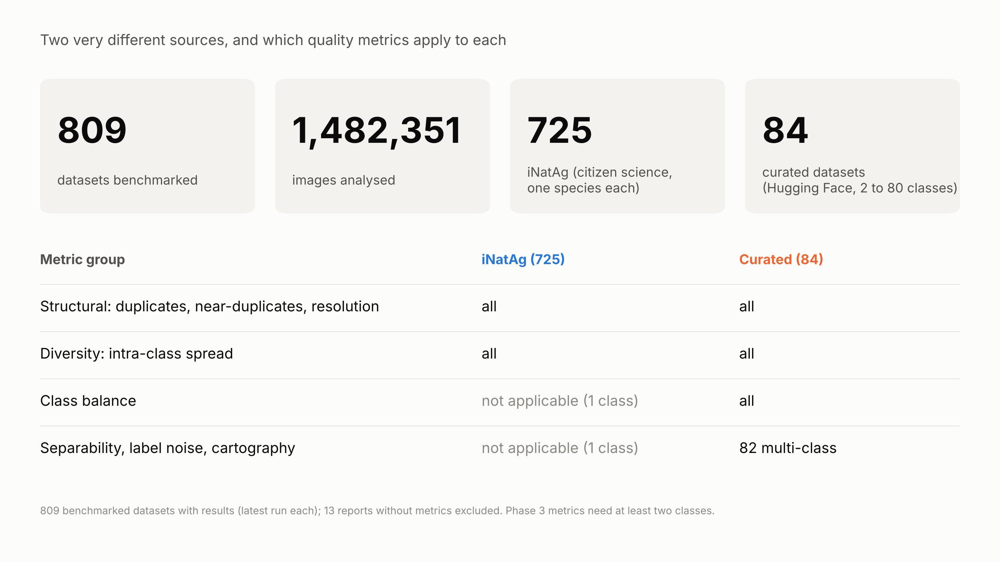
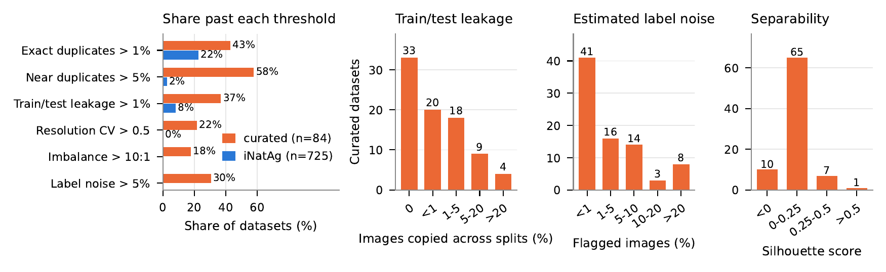
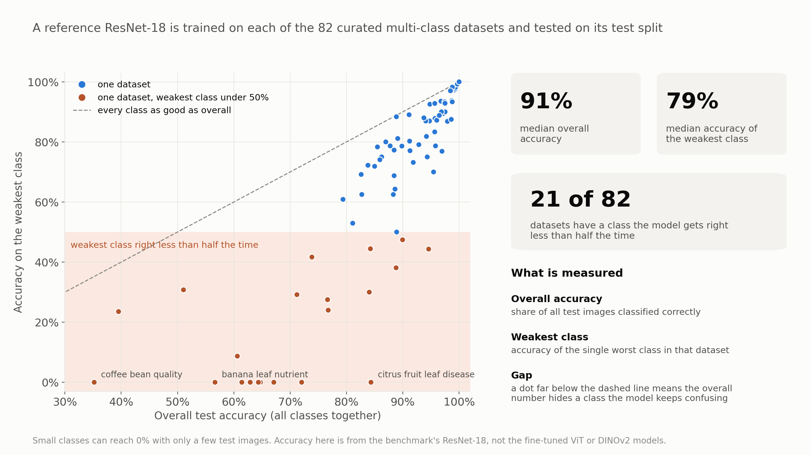
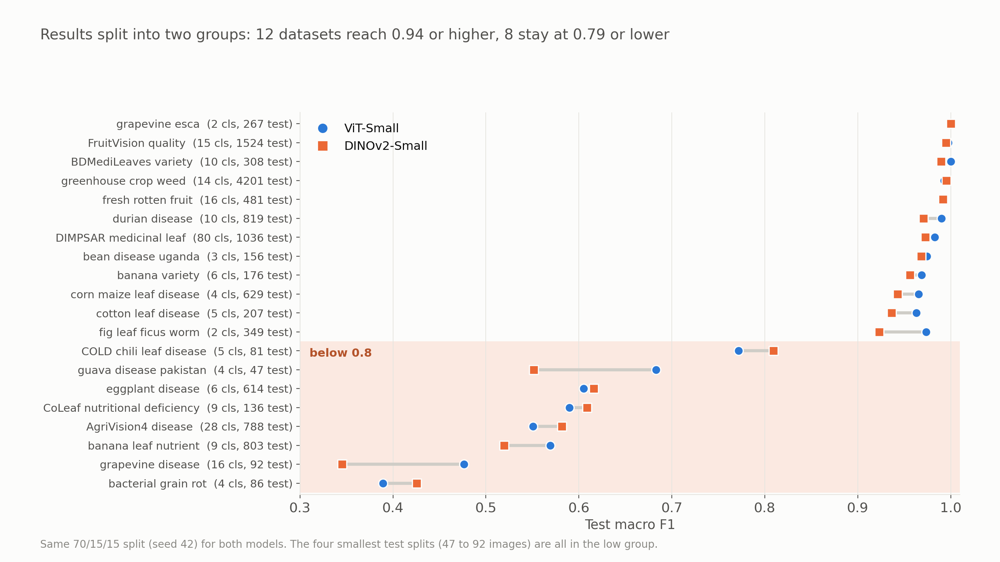
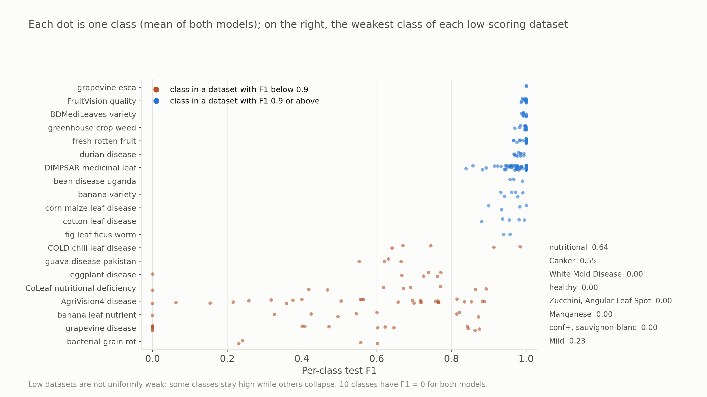
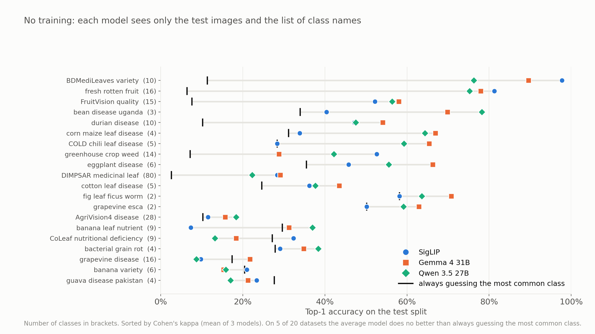
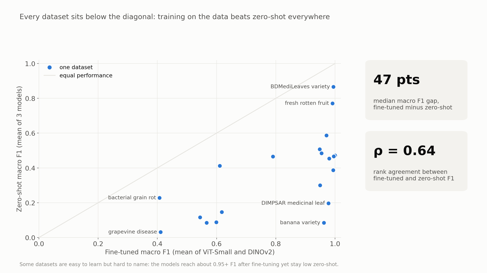
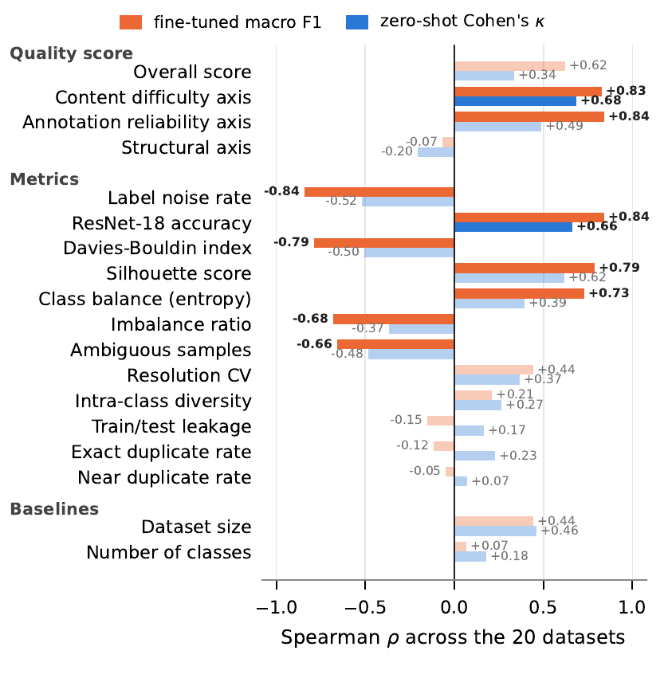

# Image Classification Results

This page sums up what the benchmark found on agricultural image classification datasets, and whether its quality scores tell us how well a model will learn a dataset. For setup and usage, see the [README](README.md). The score formulas are in [SCORING_FORMULAS.md](SCORING_FORMULAS.md).

## Contents

1. [Benchmark overview](#1-benchmark-overview)
2. [Experiments](#2-experiments)
3. [Dataset selection](#3-dataset-selection)
4. [Methodology](#4-methodology)
5. [Results](#5-results)
6. [Limitations](#6-limitations)

## 1. Benchmark overview

### 1.1 What we ran

We ran the benchmark on 809 datasets with about 1.48 million images in total:

- **84 curated datasets** from Project AgML on Hugging Face, with 2 to 80 classes each.
- **725 iNatAg subsets**, each holding photos of a single crop or weed species.

Each dataset gets an overall quality score from 0 to 10, built from four axes: structural quality, content difficulty, diversity and annotation reliability. A few runs did not produce every metric, so some counts below use 82 or 83 curated datasets and 724 iNatAg subsets.

	

### 1.2 Common problems

Quality problems are common in the curated datasets:

- 58% have more than 5% near-duplicate images (2% of iNatAg subsets).
- 43% have more than 1% exact duplicates.
- 37% have more than 1% of their images with an exact copy in another split, so the test set partly overlaps the training set. In the worst case, arabica coffee leaf disease, 98% of images have a copy in another split.
- 30% have an estimated label noise rate above 5%.

	

*(a) Share of datasets past each threshold. (b) to (d) Curated datasets by leakage, label noise and silhouette score.*

### 1.3 Label noise

Most curated datasets look clean, but a sizable group does not. The median estimated noise rate is 1.4%, while 25 of 82 datasets are above 5% and 8 are above 20% (panel c above). These are estimates from confident learning, not from relabeling, so a "noisy" image can also be a correctly labeled image that is just hard to classify.

### 1.4 How hard the classes are to tell apart

In DINOv2 embedding space, classes are poorly separated in most curated datasets. The median silhouette score is 0.11, and only 1 dataset is above 0.5 (panel d above).

A reference ResNet-18 reaches a median test accuracy of 91%, but that hides weak classes. The median accuracy of the weakest class is only 79%, and 21 datasets have a class it gets right less than half the time.

	

### 1.5 Diversity and training difficulty

Images within an iNatAg species vary much more than images within a curated class. In a typical curated dataset, 47% of same-class image pairs are very similar, compared with 2% in iNatAg (top).

Dataset cartography tracks how confident the ResNet-18 is on each training image over 30 epochs. A median of 27% of images are ambiguous, 18 datasets have more ambiguous than easy images, and almost no images are hard (bottom).

	

## 2. Experiments

The benchmark measures problems, but that only helps if the scores mean something for real models. We ran two experiments to check this:

| | Experiment 1: fine-tuning | Experiment 2: zero-shot |
|---|---|---|
| Question | Do the quality scores predict how well a model learns a dataset? | Do they predict how well a model does without any training? |
| Models | ViT-Small, DINOv2-Small | SigLIP, Gemma 4 31B, Qwen 3.5 27B |
| Measure | Macro F1 on the test split | Cohen's kappa on the test split |

## 3. Dataset selection

We picked 20 of the 82 curated datasets that have every metric. We chose them by hand, before training any model, to cover:

- a wide range of quality scores and label noise,
- dataset sizes from 306 to 28,000 images,
- 2 to 80 classes,
- different tasks: 11 disease, 3 species or variety, 2 nutrient deficiency, 2 fruit quality, 1 weed and 1 pest dataset.

Datasets with poor metrics were included on purpose (8 of the 20 are among the 15% noisiest), because a correlation needs a spread of quality. A random sample would mostly be clean datasets that all score near-perfect F1. The downside is that a wider spread can make correlations look stronger than they would on a random sample, so the results below are best read as an upper estimate.

| Dataset | Images | Classes | Quality score | Label noise | Fine-tuned F1 | Zero-shot kappa |
|---|---:|---:|---:|---:|---:|---:|
| Bacterial grain rot | 566 | 4 | 6.3 | 40.8% | 0.41 | 0.10 |
| Grapevine disease | 611 | 16 | 6.4 | 25.2% | 0.41 | 0.05 |
| Banana leaf nutrient | 5,348 | 9 | 4.8 | 27.7% | 0.54 | 0.11 |
| AgriVision4 | 5,246 | 28 | 4.7 | 22.1% | 0.57 | 0.12 |
| CoLeaf | 902 | 9 | 4.7 | 13.1% | 0.60 | 0.11 |
| Eggplant disease | 4,089 | 6 | 4.9 | 18.9% | 0.61 | 0.35 |
| Guava disease | 306 | 4 | 6.4 | 35.9% | 0.62 | -0.06 |
| COLD chili leaf | 532 | 5 | 6.7 | 8.8% | 0.79 | 0.39 |
| Fig leaf worm | 2,321 | 2 | 8.8 | 0.5% | 0.95 | 0.17 |
| Cotton leaf disease | 1,373 | 5 | 7.2 | 0.9% | 0.95 | 0.24 |
| Corn maize leaf | 4,188 | 4 | 7.6 | 1.8% | 0.95 | 0.42 |
| BananaSet | 1,166 | 6 | 8.4 | 0.2% | 0.96 | 0.01 |
| Bean disease Uganda | 1,034 | 3 | 8.8 | 0.7% | 0.97 | 0.44 |
| DIMPSAR | 6,900 | 80 | 7.1 | 0.2% | 0.98 | 0.26 |
| Durian disease | 5,451 | 10 | 6.7 | 0.5% | 0.98 | 0.44 |
| Fresh and rotten fruit | 3,200 | 16 | 7.9 | 0.0% | 0.99 | 0.77 |
| Greenhouse crop weed | 28,000 | 14 | 7.5 | 0.3% | 0.99 | 0.37 |
| BDMediLeaves | 2,048 | 10 | 8.7 | 0.0% | 0.99 | 0.87 |
| FruitVision | 10,154 | 15 | 6.3 | 2.1% | 1.00 | 0.52 |
| Grapevine esca | 1,770 | 2 | 9.0 | 0.0% | 1.00 | 0.15 |

## 4. Methodology

### 4.1 Experiment 1: fine-tuning

Both models are fine-tuned end to end with the same settings:

- 224 x 224 images, AdamW (learning rate 5e-5, weight decay 0.05), cosine schedule with 2 warm-up epochs, batch size 64.
- Light augmentation: horizontal flip, random resized crop and color jitter.
- Up to 50 epochs, stopping early if validation loss does not improve for 10 epochs.
- The best checkpoint by validation loss is scored on the test split.

Each model is trained once per dataset with seed 42, using the exact splits from the benchmark.

### 4.2 Experiment 2: zero-shot

The models only see the test image and the list of class names:

- **SigLIP** compares the image with short text prompts such as "a photo of {class}." and picks the closest class.
- **Gemma 4 and Qwen 3.5** are asked which class the image shows. They run with vLLM using FP8 weights and greedy decoding, and their output is limited to one of the class names, so every answer is valid.

### 4.3 How we compare scores and performance

- **Kappa for zero-shot.** Raw accuracy is not fair across datasets, because guessing does better with fewer classes or a dominant class. Cohen's kappa corrects for this: 0 means no better than guessing and 1 means perfect.
- **Spearman correlation (rho).** For each quality score or metric, we check whether it ranks the 20 datasets in the same order as model performance.
- **Uncertainty.** Each rho comes with a 95% bootstrap interval and a permutation p-value. Since we test 18 predictors, we flag results that pass a stricter Bonferroni threshold (p < 0.0028).

## 5. Results

### 5.1 Experiment 1: fine-tuning

The datasets split into two groups. 12 reach a macro F1 of 0.94 or higher, while 8 stay at 0.79 or lower. ViT-Small and DINOv2-Small rank the datasets almost the same way (rho = 0.96), so the result does not depend much on the model.

	

Errors are concentrated in a few classes. 10 of the 248 classes have an F1 of 0 for both models, and 6 of them are in grapevine disease.

	

### 5.2 Experiment 2: zero-shot

Zero-shot models are much weaker than fine-tuned ones. Mean accuracy is 47% for Gemma 4, 44% for Qwen 3.5 and 39% for SigLIP. On 5 of the 20 datasets, the models do no better than always guessing the most common class.

	

Fine-tuning beats zero-shot on all 20 datasets, by a median of 47 F1 points. Datasets that are hard to fine-tune also tend to be hard zero-shot, but some are easy to learn and hard to name. BananaSet, for example, reaches 0.96 F1 after fine-tuning but a kappa of only 0.01 zero-shot.

	

### 5.3 Do the quality scores predict performance?

#### Overall score

The overall quality score tracks fine-tuned F1 (rho = 0.62), but its link with zero-shot kappa is weak and not significant (rho = 0.34, p = 0.15).

	

#### Axes and individual metrics

Two axes do the work. Content difficulty and annotation reliability track fine-tuned F1 closely, while the structural axis shows no link. The diversity axis cannot be tested, because its score is 10 for all 20 datasets.

Among the individual metrics, label noise, the ResNet-18 accuracy and class separability are the strongest predictors. Duplicates and leakage show no clear link with performance, although leakage is still worth fixing because it makes test scores unreliable. For zero-shot, every link is weaker, and only content difficulty and the ResNet-18 accuracy pass the Bonferroni threshold. The overall score does no better than dataset size.

	

*Solid bars and bold values pass the Bonferroni threshold. Faded bars do not.*

### 5.4 Does the performance measure matter?

The two experiments use different measures, so we repeated each one with a second measure:

- **Fine-tuning with accuracy instead of F1:** almost the same ranking (rho = 0.98) and the same results.
- **Zero-shot with F1 instead of kappa:** the difficulty-related metrics hold, but the overall score jumps from 0.34 to 0.64. This is partly because F1 does not correct for guessing, so datasets with two or three classes look better than they are.

So the difficulty-related metrics are a reliable guide in both settings, while the overall score is only reliable for fine-tuning.

### 5.5 What this means in practice

Before training on a new dataset, the most useful checks are the estimated label noise, a quick reference model and the silhouette score. They track fine-tuned performance most closely and do not need the target model.

## 6. Limitations

- The correlations come from 20 hand-picked datasets and one training seed, so the intervals are wide.
- Label noise, ResNet-18 accuracy and cartography come from models trained on the same images, so part of their link with F1 is expected.
- All embedding metrics use DINOv2-base. Another encoder could give different values.
- The score weights and cut-offs were set by hand. The diversity sub-score maxes out at 0.4, which almost every dataset exceeds.
- Duplicates were not removed before training, so leakage may raise some F1 values.
