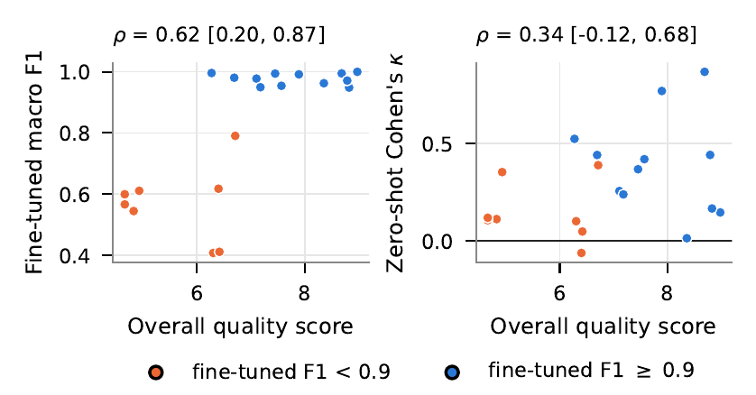
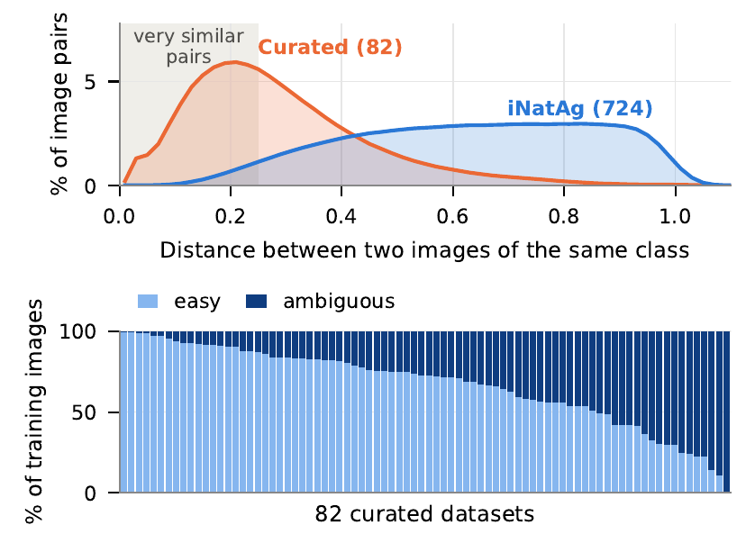
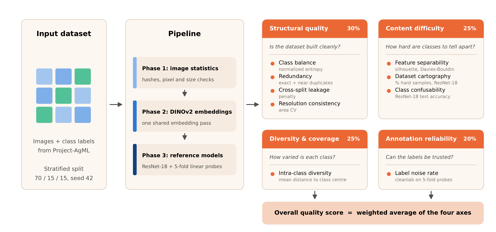

<h1 align="center">AgML Benchmarking</h1>

<p align="center">
	
	
	
	
	
	
	
	
	
	
	
</p>

A benchmark for the quality of agricultural image classification datasets. It checks each dataset for problems such as duplicates, train and test leakage, label noise and classes that are hard to tell apart, then combines the results into one quality score per dataset.

Datasets come from Hugging Face (`Project-AgML/...`) or the agml library (`iNatAg/...`, `iNatAg-mini/...`).

> **Results:** the benchmark findings and the two experiments that test whether the quality scores predict model performance are in [IMAGE_CLASSIFICATION.md](IMAGE_CLASSIFICATION.md).

<p align="center">
	<a href="IMAGE_CLASSIFICATION.md"></a>
	&nbsp;
	<a href="IMAGE_CLASSIFICATION.md"></a>
</p>

## Contents

1. [Repository layout](#repository-layout)
2. [Benchmark pipeline](#benchmark-pipeline)
3. [Experiments](#experiments)
4. [UMAP embedding format (UEB2)](#umap-embedding-format-ueb2)

## Repository layout

```
agml-benchmarking/
├── benchmark/
│   ├── app.py                        # entry point: CLI and programmatic API
│   ├── config.py                     # PipelineConfig dataclass
│   ├── requirements.txt
│   ├── configs/
│   │   └── config.json               # infrastructure settings (seeds, thresholds, paths)
│   ├── core/
│   │   ├── dataset_adapter.py        # dataset loading (HF + agml) and schema detection
│   │   ├── split_manager.py          # stratified 70 / 15 / 15 splits with _orig_idx tracking
│   │   ├── embedding_engine.py       # DINOv2 inference and on-disk embedding cache
│   │   ├── reference_trainer.py      # ResNet-18 training for Phase 3 metrics
│   │   └── umap_projector.py         # 2D UMAP projection for visualisation
│   ├── metrics/
│   │   ├── structural/               # class imbalance, exact and near duplicates, resolution
│   │   ├── diversity/                # intra-class diversity, metadata coverage
│   │   ├── difficulty/               # feature separability, cartography, class confusability
│   │   └── annotation/               # label noise (cleanlab)
│   ├── output/
│   │   └── writer.py                 # incremental JSON report writer
│   ├── figures/                      # benchmark figures and per-dataset metrics CSV
│   └── execution_scripts/
│       ├── datasets.yaml             # dataset registry: what to run and how
│       ├── run_all.py                # runs every dataset in datasets.yaml
│       ├── submit_job.py             # submits one SLURM job for all datasets
│       └── run_benchmark.sbatch      # SLURM job template (FARM @ UC Davis)
├── experiments/
│   ├── config.yaml                   # shared settings and the 20 evaluation datasets
│   ├── common/                       # dataset preparation, metrics, reproducibility helpers
│   ├── fine_tuning/                  # Experiment 1: ViT-Small and DINOv2-Small fine-tuning
│   ├── zero_shot/                    # Experiment 2: SigLIP, Gemma 4 and Qwen 3.5
│   ├── fine_tuning.sbatch
│   ├── zero_shot.sbatch
│   ├── requirements.txt              # extra packages for Experiment 1
│   ├── requirements_zero_shot.txt    # full environment for Experiment 2 (vLLM)
│   ├── results/                      # per-run JSON results and summaries
│   └── figures/                      # fine-tuning and zero-shot figures
├── IMAGE_CLASSIFICATION.md           # results and experiments write-up
├── SCORING_FORMULAS.md               # metric formulas, axis weights, overall score
└── README.md
```

## Benchmark pipeline

### How it works

Each dataset is split into train, validation and test sets (70/15/15, stratified by class, seed 42). It then goes through three phases, each building on the one before. Every metric feeds one of four quality axes, and the axes are combined into one overall score from 0 to 10.

<p align="center">
	
</p>

### Phases and metrics

| Phase | Runs on | Metric | What it checks | Axis |
|---|---|---|---|---|
| 1. Image statistics | CPU | Class imbalance | How evenly images are spread over classes | Structural |
| | | Exact duplicates | Identical images, found by hashing pixels | Structural |
| | | Resolution consistency | How much image sizes vary | Structural |
| | | Metadata coverage | Class by metadata tables | Not scored |
| 2. DINOv2 embeddings | GPU | Near duplicates | Very similar images (cosine similarity 0.98 or more) | Structural |
| | | Train and test leakage | Duplicate groups that span splits | Structural (penalty) |
| | | Feature separability | Silhouette score and Davies-Bouldin index | Content difficulty |
| | | Intra-class diversity | Mean distance to the class centroid | Diversity |
| 3. Reference models | GPU | Label noise | Likely mislabeled images (cleanlab, 5-fold) | Annotation |
| | | Class confusability | Test accuracy of a ResNet-18 | Content difficulty |
| | | Dataset cartography | Easy, ambiguous and hard images over 30 epochs | Content difficulty |

Separability, label noise, confusability and cartography need two or more classes, so they are skipped for single-species iNatAg subsets. Phase 2 also saves a 2D UMAP projection for visualisation.

### Quality score

| Axis | Weight | Built from |
|---|---|---|
| Structural quality | 30% | Class balance, duplicates, resolution, minus a leakage penalty |
| Content difficulty | 25% | Separability, cartography, confusability |
| Diversity and coverage | 25% | Intra-class diversity |
| Annotation reliability | 20% | Label noise |

If an axis cannot be computed, its weight is shared out among the others. The full formulas are in [SCORING_FORMULAS.md](SCORING_FORMULAS.md).

### Dataset sources

| Prefix | Source | Example |
|---|---|---|
| `Project-AgML/...` | Hugging Face | `Project-AgML/rice_leaf_disease_classification` |
| `iNatAg/<name>` | agml library | `iNatAg/acacia_auriculiformis` |
| `iNatAg-mini/<name>` | agml library | `iNatAg-mini/acacia_auriculiformis` |

For compound labels (for example crop type and disease), pass `--compound-label-cols` to join several columns into one stratified label.

### Configuration

Infrastructure settings live in `benchmark/configs/config.json` and are found at startup in this order:

1. The `$AGML_CONFIG` environment variable
2. `benchmark/config.json` in the working directory
3. Built-in defaults

Key settings:

```json
{
  "split_seed": 42,
  "train_ratio": 0.70,
  "val_ratio": 0.15,
  "embed_model": "facebook/dinov2-base",
  "embed_batch_size": 64,
  "near_dup_threshold": 0.98,
  "backbone": "resnet18",
  "cartography_epochs": 30,
  "cv_folds": 5
}
```

Dataset-specific arguments (name, column names, compound labels) are passed at runtime, not stored in the config.

### Running the benchmark

#### Setup on FARM

```bash
module load cuda/12
export UV_PROJECT_ENVIRONMENT=/group/jmearlesgrp/$USER/agml-benchmarking/.agml-benchmarking/
export HF_HOME=/group/jmearlesgrp/$USER/hf
```

Download datasets and the DINOv2 model from the **login node** first, since compute nodes may not have internet access:

```bash
# Dataset
python -c "
from datasets import load_dataset
load_dataset('Project-AgML/rice_leaf_disease_classification')
"

# DINOv2 (Phase 2)
python -c "
from transformers import AutoModel, AutoImageProcessor
AutoImageProcessor.from_pretrained('facebook/dinov2-base')
AutoModel.from_pretrained('facebook/dinov2-base')
"
```

#### Single dataset

```bash
# Simple
python -m benchmark.app \
    --dataset Project-AgML/rice_leaf_disease_classification \
    --phases 1 2 3

# If the HF dataset has several configurations (e.g. default, train, raw)
python -m benchmark.app \
    --dataset Project-AgML/watermelon_disease_classification \
    --hf-config-name raw \
    --phases 1 2 3

# Compound label (joins crop_type and label into one class)
python -m benchmark.app \
    --dataset Project-AgML/crop_pest_disease_classification \
    --compound-label-cols label crop \
    --phases 1 2 3

# iNatAg dataset via agml
python -m benchmark.app \
    --dataset iNatAg-mini/acacia_auriculiformis \
    --phases 1 2 3
```

#### Many datasets

List the datasets in `benchmark/execution_scripts/datasets.yaml`. Each entry inherits from `defaults` and can override schema fields:

```yaml
defaults:
  phases: "1 2 3"
  hf_config_name: ""
  label_col: "label"
  image_col: "image"
  compound_label_cols: []

datasets:
  - name: "Project-AgML/corn_leaf_pest_classification"
  - name: "Project-AgML/date_grade_variety_classification"
    compound_label_cols: ["label", "variety", "size"]
  - name: "iNatAg-mini/acacia_auriculiformis"
```

Then submit one SLURM job for all of them, or run them locally:

```bash
python benchmark/execution_scripts/submit_job.py   # SLURM
python benchmark/execution_scripts/run_all.py      # local
```

The datasets run one after another in a single job (48 hour limit, 64 GB GPU). If one fails, the error goes to the `.err` log and the next one starts. Logs are written to `benchmark/logs/YYYY-MM-DD/`.

### Output

Each run writes to `benchmark_results/<dataset_name>/`:

```
benchmark_results/rice_leaf_disease_classification/
├── result.json          # all metric outputs and reproducibility metadata
├── config_used.json     # exact config snapshot for the run
└── embeddings/
    ├── embeddings.npy   # DINOv2 CLS embeddings, shape (N, 768), L2-normalised
    ├── labels.npy       # integer labels, shape (N,)
    └── umap_projection.bin
```

Results are saved as each phase finishes, so if a job is killed, the completed phases are kept.

## Experiments

Two experiments test whether the quality scores predict model performance on 20 curated datasets. Both use the same splits as the benchmark. Settings and the dataset list are in `experiments/config.yaml`.

### Experiment 1: fine-tuning

Fine-tunes ViT-Small (AugReg) and DINOv2-Small from timm on each dataset and reports test macro F1.

```bash
sbatch experiments/fine_tuning.sbatch
# One dataset and model only
sbatch experiments/fine_tuning.sbatch --datasets bean_disease_uganda --models vit_small
```

### Experiment 2: zero-shot

Classifies test images with SigLIP, Gemma 4 31B and Qwen 3.5 27B without any training. It needs its own environment because vLLM brings its own PyTorch build:

```bash
uv pip install "vllm>=0.29.0" && uv pip install -r experiments/requirements_zero_shot.txt
sbatch experiments/zero_shot.sbatch
```

### Shared options

Both runners accept the same flags:

| Flag | Meaning |
|---|---|
| `--config` | Path to a config file (default `experiments/config.yaml`) |
| `--datasets` | Comma separated dataset names to run |
| `--models` | Comma separated model names to run |
| `--prefetch-only` | Download datasets and weights, then exit (run this on the login node) |

Results are written to `experiments/results/`, and the figures used in [IMAGE_CLASSIFICATION.md](IMAGE_CLASSIFICATION.md) are in `experiments/figures/`.

## UMAP embedding format (UEB2)

### Purpose

Per-dataset UMAP projection data (2D and 3D scatter coordinates, one row per
sample) used to be stored as two JSON files per dataset:
<dataset>_umap_2D.json   -> [{ x, y, label, split, index }, ...]
<dataset>_umap_3D.json   -> [{ x, y, z, label, split, index }, ...]

This is now stored as one custom binary file per dataset:
<dataset>_umap.bin

`UEB2` is a made-up format name ("UMAP Embedding Binary, version 2"), not an
external/standard format. The name only matters as a magic-byte signature so a
reader can confirm it's looking at the right kind of file.

Why binary at all: JSON re-encodes every float as decimal text and repeats the
same label/split strings on every row. For ~200 datasets this JSON totaled
~88MB. Deduplicating labels/splits into small tables, referencing them by
index, and storing coordinates as 4-byte float32 instead of text cuts total
size to ~15MB (83% smaller) with no loss of precision that matters for a
scatter plot.

### Core invariant (must hold before writing)
**A pipeline change must assert this before writing**, e.g.:

```python
assert len(points_2d) == len(points_3d)
for a, b in zip(points_2d, points_3d):
    assert a["label"] == b["label"]
    assert a.get("split", "train") == b.get("split", "train")
    assert a.get("index") == b.get("index")
```

If this ever stops holding (e.g. the 2D and 3D fits get produced from
differently-ordered or differently-filtered sample sets), the format doesn't
error. It silently attaches row i's label/split/index to the wrong
coordinates in whichever block was reordered.

### Byte layout
All multi-byte integers and floats are little-endian.
```
offset 0    4 bytes    magic = ASCII "UEB2"
offset 4    1 byte     uint8  flags         bit0 = has 2D coords section
                                            bit1 = has 3D coords section
offset 5    2 bytes    uint16 labelCount
offset 7    1 byte     uint8  splitCount
offset 8    4 bytes    uint32 pointCount

--- label table: labelCount entries ---
each entry:
    1 byte      uint8 len
    len bytes   UTF-8 string (the class/label name)

--- split table: splitCount entries ---
each entry:
    1 byte      uint8 len
    len bytes   UTF-8 string (e.g. "train" / "val" / "test")

--- metadata block: pointCount records, shared by both coordinate sets ---
each record (7 bytes):
    2 bytes     uint16 labelIdx     (index into label table)
    1 byte      uint8  splitIdx     (index into split table)
    4 bytes     uint32 index        (original sample index)

--- 2D coordinate block: pointCount records, ONLY present if flags bit0 set ---
each record (8 bytes):
    4 bytes     float32 x
    4 bytes     float32 y

--- 3D coordinate block: pointCount records, ONLY present if flags bit1 set ---
each record (12 bytes):
    4 bytes     float32 x
    4 bytes     float32 y
    4 bytes     float32 z
Point record sizes: 7 bytes metadata + 8 bytes per 2D point + 12
bytes per 3D point (when both sections are present).
```

#### Worked example
3 points, 2 labels (Cat, Dog), 2 splits (test, train), both 2D and 3D
present. Labels/splits are sorted alphabetically and assigned indices in that
order: Cat=0, Dog=1, test=0, train=1 (sort order isn't required by the
reader, it's just how the reference writer builds the table deterministically).
```
     x     y     z   label   split  index 
0   1.5   2.5   3.5   Cat   train   0 
1   -0.25 4.0   1.0   Dog   test    1 
2   0.0   0.0   0.0   Cat   train   2 
```

Resulting 112-byte file:
```
0  55 45 42 32                      magic "UEB2"
4  03                               flags = 0b11 (2D + 3D both present)
5  02 00                            labelCount = 2
7  02                               splitCount = 2
8  03 00 00 00                      pointCount = 3

12  03 43 61 74                      label[0]: len=3, "Cat"
16  03 44 6f 67                      label[1]: len=3, "Dog"
20  04 74 65 73 74                   split[0]: len=4, "test"
25  05 74 72 61 69 6e                split[1]: len=5, "train"

31  00 00 01 00 00 00 00             meta[0]: labelIdx=0(Cat) splitIdx=1(train) index=0
38  01 00 00 01 00 00 00             meta[1]: labelIdx=1(Dog) splitIdx=0(test)  index=1
45  00 00 01 02 00 00 00             meta[2]: labelIdx=0(Cat) splitIdx=1(train) index=2

52  00 00 c0 3f 00 00 20 40          2D[0]: x=1.5, y=2.5
60  00 00 80 be 00 00 80 40          2D[1]: x=-0.25, y=4.0
68  00 00 00 00 00 00 00 00          2D[2]: x=0.0, y=0.0

76  00 00 c0 3f 00 00 20 40 00 00 60 40   3D[0]: x=1.5, y=2.5, z=3.5
88  00 00 80 be 00 00 80 40 00 00 80 3f   3D[1]: x=-0.25, y=4.0, z=1.0
100  00 00 00 00 00 00 00 00 00 00 00 00   3D[2]: x=0.0, y=0.0, z=0.0
```


#### Reading (reference implementation)
A function named parseEmbeddingBinary(buffer) is the canonical
reader. Steps, in order, tracking a running offset:

1. **Header Check:** Read 4 bytes, confirm they equal `"UEB2"`. If not, return `null` / empty result (do not throw).
2. **Flags:** Read `flags` (uint8):
   * `has2d = (flags & 1) !== 0`
   * `has3d = (flags & 2) !== 0`
3. **Counts:** Read `labelCount` (uint16), `splitCount` (uint8), and `pointCount` (uint32).
4. **Labels:** Loop `labelCount` times: read 1-byte length $L$, then decode $L$ bytes as UTF-8 string $\rightarrow$ push onto `labels`.
5. **Splits:** Loop `splitCount` times: read 1-byte length $L$, then decode $L$ bytes as UTF-8 string $\rightarrow$ push onto `splits`.
6. **Metadata Arrays:**
   * Read `pointCount` uint16s into `labelIdx`.
   * Read `pointCount` uint8s into `splitIdx`.
   * Read `pointCount` uint32s into `index`.
7. **2D Coordinates Block (if `has2d`):**
   * Loop `i` from `0` to `pointCount - 1`:
     * Read `x` (float32), `y` (float32).
     * Resolve `label = labels[labelIdx[i]]` and `split = splits[splitIdx[i]]`.
     * Construct point object `{ label, split, index: index[i], x, y }` and push to `points2D`.
8. **3D Coordinates Block (if `has3d`):**
   * Loop `i` from `0` to `pointCount - 1`:
     * Read `x` (float32), `y` (float32), `z` (float32).
     * Resolve `label = labels[labelIdx[i]]` and `split = splits[splitIdx[i]]`.
     * Construct point object `{ label, split, index: index[i], x, y, z }` and push to `points3D`.
9. **Return:** Return `points2D` (or `null` if `!has2d`) and `points3D` (or `null` if `!has3d`).


### File paths
Same naming/nesting convention as before, minus the _2D/_3D suffix:
```
static/data/dataset-benchmarking/embeddings/<dataset>_umap.bin
static/data/dataset-benchmarking/embeddings/iNatAg/<species>_umap.bin
static/data/dataset-benchmarking/embeddings/iNatAg-mini/<species>_umap.bin
```